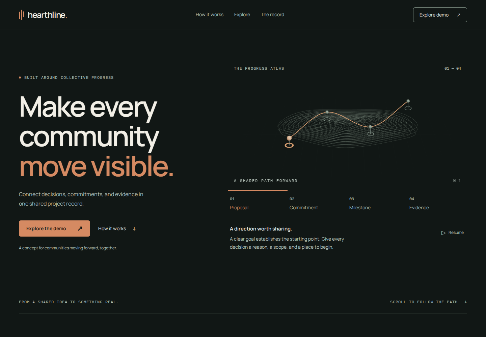

# Hearthline — Progress Atlas

An original single-page community-coordination concept, implemented with Next.js App Router, TypeScript, CSS Modules, and an optional procedural WebGL atlas. The Open Access Toolkit demo connects decisions, contributor commitments, milestones, and evidence.



## Run locally

Use Node.js 20.9 or newer (verified with Node 24.19.0) and npm.

```sh
npm ci
npm run dev
```

Open http://localhost:3000. For the verified production path:

```sh
npm run lint
npm run typecheck
npm run build
npm run start
```

## Verification

```sh
npx playwright install --with-deps chromium firefox webkit
npm test
```

The test runner starts the production server automatically when it is not already running. Build first. If a browser CDN returns an invalid archive, Playwright's alternate mirror may succeed; no checks should be silently skipped because of a download failure.

With a production server running, `npm run measure` records a throttled Chromium sample in `artifacts/performance.json`. It uses software WebGL and does not establish physical mobile-device or field performance.

See [VERIFICATION.md](VERIFICATION.md) for measured results and known limits. Desktop and mobile captures are in [docs/screenshots](docs/screenshots).

## Experience

- Four atlas stages update a shared HTML explanation and visual selection.
- Design, Build, Review, and View all filter local demo records without requests or persistence.
- Native record disclosures remain usable without JavaScript.
- Reduced motion and saved-data preference use the lightweight SVG atlas.
- The scene loads separately; pause, offscreen state, and hidden document state stop continuous rendering. Context loss or a failed scene chunk preserves the core experience.
- Keyboard/touch controls, visible focus, a mobile menu with Escape dismissal, and responsive layouts down to 320 px.

## Architecture

`app/page.tsx` and `app/layout.tsx` compose server-rendered content. Navigation, atlas state, and the workstream demo are small client boundaries. `components/hearthline/atlas/AtlasScene.tsx` contains the only browser-only renderer. Shared fictional data and deterministic geometry live in `lib/hearthline/`.

Runtime dependencies are Next.js 16.3.7, React/React DOM 19.3.0, Three.js 0.186.1, and React Three Fiber 9.8.1. CSS handles DOM transitions; no DOM animation library, UI kit, backend, authentication, or wallet integration is installed.

## Project guidance

- [AGENTS.md](AGENTS.md): repository operating instructions.
- [DESIGN.md](DESIGN.md): approved original visual direction, with reference-inspection limitations retained.
- [IMPLEMENTATION_PLAN.md](IMPLEMENTATION_PLAN.md): implementation baseline.
- [ASSETS.md](ASSETS.md): font licenses and original asset provenance.
- [.agents/skills](.agents/skills): the twelve reusable website-building skills.

This is a fictional product concept. No deployment or real community transaction has been performed.
